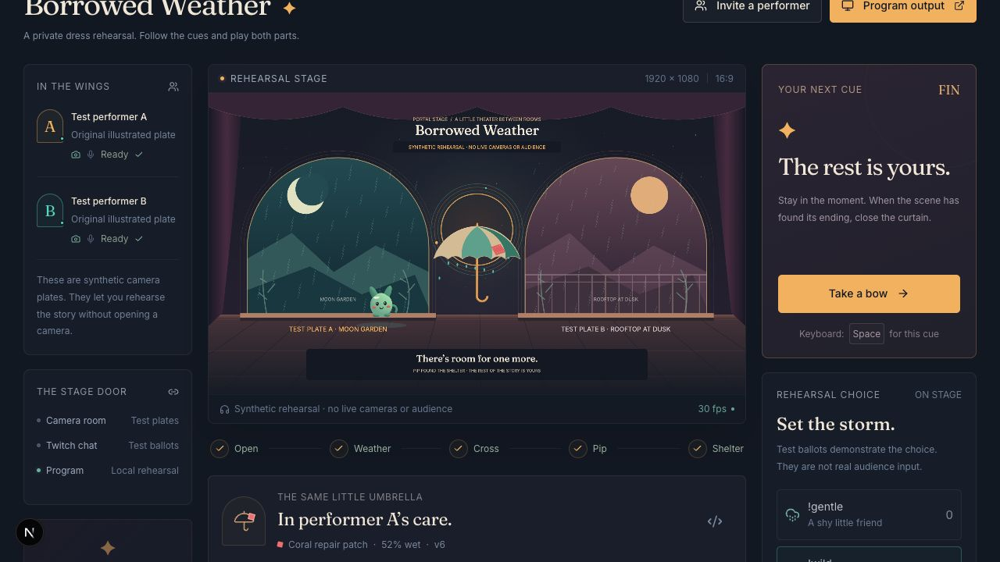

# PORTAL STAGE

**Your room. An impossible visitor. A story your Twitch community helps write.**

PORTAL STAGE is a small live theater: people improvise, chat makes authored choices, and the same virtual prop travels between rooms. Play with a consenting guest, or perform solo opposite an illustrated **Audience Room**. The software handles stagecraft; no runtime language model controls the performance.



_Illustrated rehearsal, not camera footage or evidence of remote performers._

**[Open the live site](https://portal-stage-eight.vercel.app)** · [How it works](docs/architecture.md) · [Verification record](docs/evidence/README.md)

This review branch adds the expanded audience choices, local camera trial, capped solo sessions, and Midnight Parcel. Their browser and deployment checks are tracked separately from the earlier release in the [review checkpoint](docs/evidence/review-implementation.md).

## Try it in 60 seconds

1. Open Studio, choose **Borrowed Weather**, and **Start a rehearsal**. No account or camera is required.
2. Open the curtain and weather choice. Cast a clearly labeled test ballot, close the choice, and let it rain.
3. Offer the patched umbrella and accept as illustrated part B. Its new owner is committed before it crosses the portal.
4. Continue with the cue card: name the visitor, choose its mood, bring the umbrella home, and choose a shared shelter or playful chase.

Try **Midnight Parcel** for a different story: choose a pocket of stars or a midnight garden, stamp a tagged parcel, send it across, and change the receiving room. Its tag and handling marks survive the return; the final choice decides which room keeps the gift.

**Try a local camera & hand cues** is optional inside ordinary rehearsal. Give local preview consent, enable the camera, confirm framing, enable hand cues, and arm them. Your camera and landmarks stay in that browser; rehearsal requests no microphone or media room. Offer/Accept buttons remain available. Framing and dwell have automated tests; physical hand accuracy is still an acceptance task.

## With real Twitch chat

Sign in with Twitch and create a **solo Twitch show**, subject to the displayed shared allowance. You prepare, consent, and admit your own camera. The illustrated Audience Room needs no guest invitation: chat's `!accept`/`!wait` choice receives the prop, and `!giveback`/`!keep` decides its return. You explicitly accept it back.

Both modes offer weather (`!gentle`/`!wild`), a fixed visitor name (`!pip1`/`!pip2`/`!pip3`), mood (`!curious`/`!shy`), and ending (`!share`/`!chase`) choices. Parcel uses `!stars`/`!garden` and `!deliver`/`!keep`. Bounded `!rain`, `!thunder`, and `!cheer` effects let chat stay present. Each account has one replaceable ballot per window. Empty or tied results wait for an explicit, labeled Director's choice.

The host browser relays Twitch EventSub messages in bounded batches; Twitch credentials stay on the server. This is an authenticated browser relay, not a signed webhook provenance claim. Public viewers stay on Twitch and receive no LiveKit token. The app does not post chat messages or start a broadcast.

Invited hosts can also create a two-performer show. Camera preview, broadcast consent, recording consent, readiness, and admission are separate. A receive-only Program view is intended for a separately verified OBS capture setup. Two humans on separate networks, microphones/echo, physical gesture alignment, and actual OBS capture remain distinct checks; local or synthetic runs do not establish them.

## Run locally

Use **Node.js 22.x**. Fonts, original stage art, and the hand-landmark runtime are bundled; no model API key is needed.

```sh
npm ci
npm run setup
npm run dev
```

Open [localhost:3200](http://localhost:3200). Rehearsal works with the local atomic file store. Real solo requires PostgreSQL, Twitch, LiveKit, and a confirmed durable expiry workflow. Default solo limits are three starts per account per UTC day, thirty globally, five concurrent reservations, and twenty minutes per session. Failed uncertain scheduling retains its daily charge and issues no media access. Local camera rehearsal does not consume a solo media allowance.

```sh
npm run typecheck
npm test
npm run format:check
npm run build
```

Stop the dev server before building, or use an isolated copy with its own `.next`. [Setup](docs/setup.md) covers providers, Workflow, limits, private guest invitations, output pairing, and labeled local transport QA. [Media](docs/media.md), [gestures](docs/gestures.md), [privacy](docs/privacy.md), and [rights](docs/rights.md) describe the boundaries.

## Built with Codex

Codex helped implement and review the ownership protocol, exact-page fencing, private media routing, first-frame recovery, local camera cancellation, audience grammar, and durable solo closure. The [development record](docs/evidence/codex.md) links concrete source and tests. Main development conversation: **01a190da-3cee-7a10-b7c1-e0cdbb379510**; implementation lead: **01a191d6-551a-7cd2-9cd8-30611a7ee60b**.

The [evidence ledger](docs/evidence/README.md) preserves source, conditions, actual counts, and pending checks. Private plans, credentials, consent receipts, and camera recordings stay out of Git. The repository contains the operating documentation and permitted assets needed for a fresh clone.
