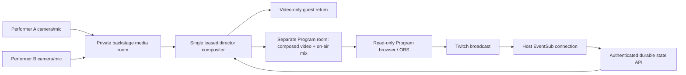

# Architecture and behavioral contracts

The director browser owns one Three.js/WebGL compositor. PostgreSQL orders semantic changes; LiveKit transports media; Twitch distributes the eventual OBS broadcast. Public Twitch viewers do not join LiveKit.

## State and ownership

`src/server/core.ts` is the synchronous authored show protocol. Every command is validated by role, current epoch, expected prop version where relevant, and bounded idempotency key. The store retries its pure mutation under a PostgreSQL compare-and-swap revision. Production never uses an in-memory show map. A development file store uses a cross-process lock and atomic rename.

The stable umbrella ID, coral patch, wetness, and owner live in a durable snapshot. Offer preserves owner A. Receiver acceptance atomically commits owner B and a transfer event **before** animation. The renderer first observes that committed snapshot, then runs the full artistic crossing from a local presentation clock. Arrival only acknowledges presentation; it does not commit ownership again. Decline/expiry before acceptance retain A. A failed arrival retains B. Recall is a new committed ownership event.

`sequence` orders semantic evidence events. `revision` advances on every stored show update, including lease renewals, liveness, and durable calibration changes. Clients ignore older revisions, preventing delayed quiet responses from overwriting current state. Idempotency memos are bounded on every code path. JSON hashes canonicalize sorted object keys to survive PostgreSQL JSONB ordering.

The director lease lasts 45 seconds and carries an epoch. A per-show renderer ID survives in session storage, while each page mount gets a new incarnation ID and increasing sequence. A prompt reload preserves the cue and unexpired offer. An exact-incarnation pagehide release cannot release a newer mount; Program holds until reclaim. Renewals use one conditional PostgreSQL update checked against owner, client, incarnation, epoch, expiry, and a persistent rate cap. Client renewals are single-flight and independent of semantic-command reconciliation. Initial acquisition and takeover retain the compare-and-swap path. A takeover fences the old renderer, cancels uncommitted offers, and holds the show. Live media requires fresh readiness/admission; ordinary synthetic rehearsal restores its named plates while retaining the story. Explicit transport mode distinguishes these behaviors even inside a labeled rehearsal.

## Media and consent

Signed HttpOnly sessions and redeemed invitations bind one performer slot. Consent, devices, calibration, Ready, and director admission are distinct server fields. Guests cannot admit themselves or control another camera. In actual media transport, only the receiver's session accepts a handoff. Only ordinary solo rehearsal permits the director to play both roles.

The private backstage room contains camera/microphone tracks and a video-only return. A separate Program room contains composed video plus an audio mix gated by phase, connection, admission, and consent. Output viewers cannot publish, send data, change metadata, record, administer, or enter backstage. Media grants expire after 120 seconds for initial connection; established connections may renew, so explicit participant removal also enforces revocation.

A local emergency latch covers the picture and gates the output mix immediately. Program independently detaches its audio on hold or expired renderer authority. A newer panic cannot be cleared by an older pending resume response. Server panic holds the show, hides both performers, cancels uncommitted offers, and requires readiness/admission again for actual media. Reconnect stops local media and returns muted backstage. A stalled camera becomes a named closed aperture.

Landmarks run locally in a same-origin worker and control only an armed cue/calibrated virtual anchor. They do not identify people or physical umbrellas. Calibrated fallback positions are durable. Live hand positions travel as bounded, lossy data messages inside the private LiveKit room: at most one latest sample per slot, with signed participant identity/role, show/epoch, finite coordinates, age, order, and rate checks. Missing samples expire after 1.5 seconds to the calibrated fallback. No offer, acceptance, or ownership is authorized by this data path. Actual hand alignment and latency remain measurement tasks.

## Audience trust boundary

The authenticated director receives Twitch EventSub WebSocket notifications. Tokens stay server-side. Forwarded envelopes must match the active subscription/channel, bounded timestamps/identifiers, and director lease. Literal gentle/wild commands become hashed ballots. Each account has one replaceable choice per round; message IDs deduplicate delivery.

The authorized host browser is a trust boundary: hosts can modify their own forwarded payloads. The trace establishes application handling; genuine Twitch provenance requires an actual message/connection capture. This is not a signed webhook audit. Disconnects cancel open rounds, missed messages cannot be reconstructed, and empty/tied rounds visibly use Director's choice.

## Bounded operation

Two performer slots; backstage caps at 3 participants and output at 4. APIs enforce same-origin mutations, body limits, ownership, rate caps, expiring/revocable invitations, and read-only output pairing. A newly issued invitation replaces the prior unused code for that slot without changing a joined guest or existing output grants; explicit guest revocation advances only invitation access. Program grants have an independent output generation that changes on explicit unpair or end. Legacy pairings adopt the current invitation generation before separation; revoked grants are never revived. Unpair removes Program viewers while preserving the publisher and backstage. Up to 64 issued viewer identities are retained so unconnected grants can also be revoked. A show retains the latest 2,000 semantic events and 1,000 idempotency memos. A round admits at most 2,000 unique voters; a show retains at most 5,000 accepted message IDs. These are operational limits, not observed audience demand.

Rehearsal access expires after 24 hours; live-show access after 7 days. Records are not automatically erased at expiry. See [privacy](privacy.md) for actual retention. The app records no raw media and makes no runtime LLM calls.
