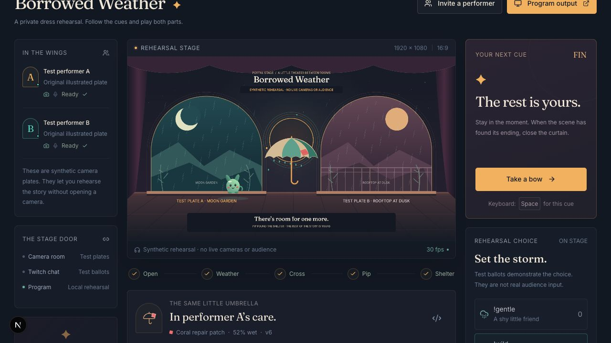
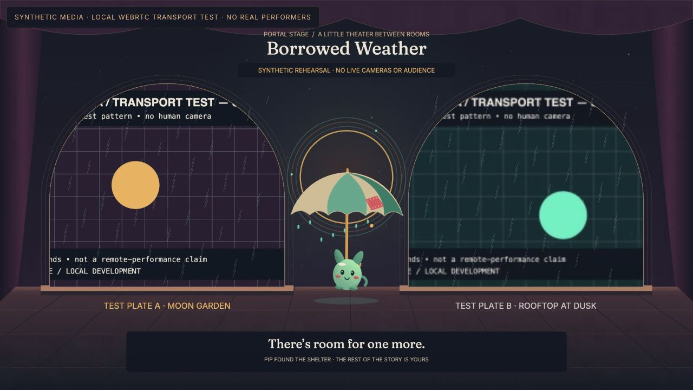
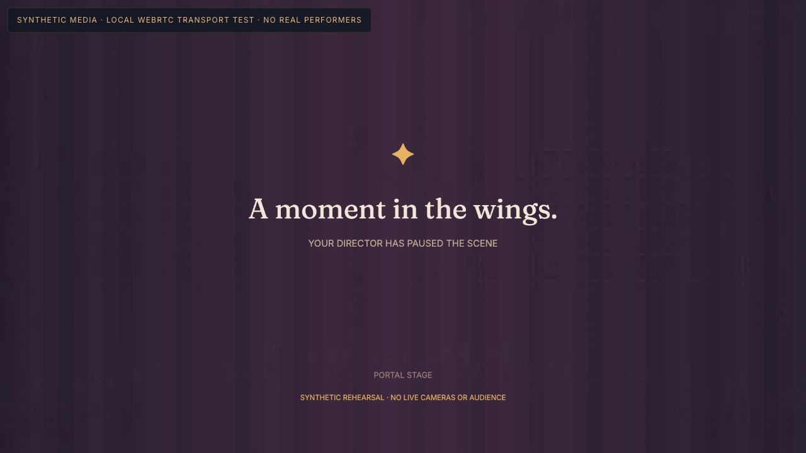
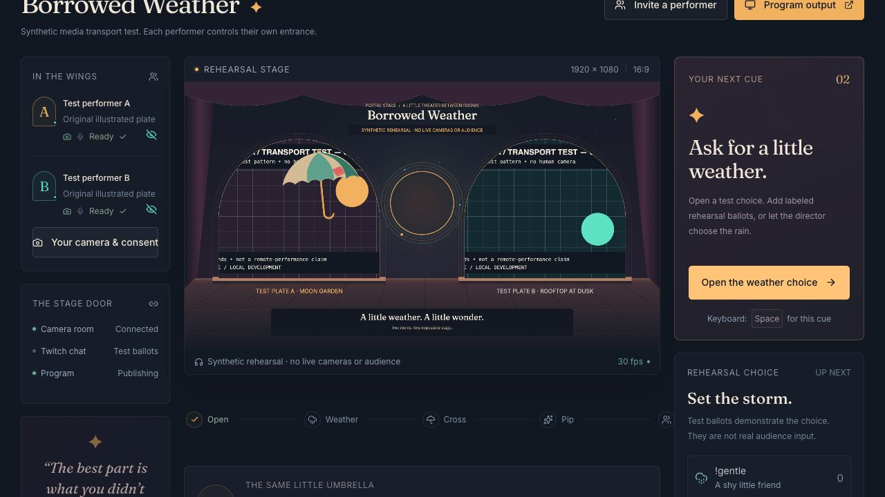

# Local in-app browser verification

Observed on 31 October 2026 in the Codex in-app browser. This record distinguishes the ordinary illustrated rehearsal, actual local WebRTC transport using generated video, and human performance evidence.

## Completed checks

| Check                               | Observed result                                                                                                                                                                                                               |
| ----------------------------------- | ----------------------------------------------------------------------------------------------------------------------------------------------------------------------------------------------------------------------------- |
| Landing at 390 × 844                | Document width equals viewport width; no horizontal overflow. Hero and primary action remain readable.                                                                                                                        |
| Director console at 390 × 844       | No horizontal overflow; stage, status, and controls remain reachable.                                                                                                                                                         |
| Complete Borrowed Weather rehearsal | Open curtain → wild test ballot → close choice → rain → A offers/B accepts → arrival → Pip hatches → B offers/A accepts → arrival → shared shelter → end.                                                                     |
| Persistent prop                     | The same umbrella retained its coral patch and 52% wetness through both crossings. Owner returned to A at version 6; arrival did not increment the ownership version.                                                         |
| Recovery                            | An initial fixture-readiness defect was fixed. Reload recovery preserved the umbrella, weather, and creature; explicit Resume completed the original ending without resetting the scene.                                      |
| Authoring                           | Saved “Moonlit Mischief” with creature Sprig, wild fallback, and playful-chase ending. It survived reload. Loading it and resetting changed the stage title/creature and created a fresh prop at version 1 with zero wetness. |
| Real Twitch connection              | The existing authorized Twitch account completed the exact local OAuth callback with read-chat scope. A live show established EventSub and displayed Listening for `!gentle` / `!wild`. No public chat messages were posted.  |
| Guest layout                        | At 390 × 844, independent guest setup had no horizontal overflow and exposed preview, consent, and readiness separately.                                                                                                      |
| Keyboard framing                    | Right/left arrows moved and restored the mirrored framing marker. This does not test hand-landmark recognition.                                                                                                               |

The complete story was exercised in show `ps_e5c6169cba0bdb87`. Its [exported trace](local-rehearsal-trace.json) is a browser-exported recent event window, not a complete immutable audit log. The [ending screenshot](local-rehearsal-shelter.jpg) shows the actual rendered rehearsal.

## Local media test — initial run

Director and guest used independent cookies on `localhost:3200` and `127.0.0.1:3201`, a real Neon database, and official LiveKit Server 1.13.11 bound to localhost. Both sources were moving generated test plates. No physical camera or microphone was accessed.

The director connected and published its composed Program. The guest entered through a private invitation, enabled synthetic video, granted broadcast permission only, confirmed framing, connected through WebRTC, and marked ready. During admission, a slow control request caused the director's lease to expire: the stage held, the old director/program disconnected, and the guest remained private backstage. A separate LiveKit server inspection confirmed that no old program publisher lingered. The receive-only Program page displayed its holding screen with an explicit synthetic-test label.

A second frozen-source development run established the separate Program video and both camera sessions, but also failed before the story could begin. Multiple control reads, writes, and renewals took 8–14 seconds and some returned timeouts. The host was simultaneously running unrelated CPU-intensive rendering work; the evidence does not isolate one cause. The project is being checked in an optimized local build with further recovery fixes. Neither initial media run is a full pass.

## Optimized local media run — complete protocol and recovery

After the queue, lease, and geometry corrections, the optimized Next.js build ran on the same two loopback origins with the explicit local-only media-test flag. A fresh show, `ps_be6f6a5394a26133`, used independent host/guest cookies and real LiveKit transport with generated moving video. The browser remained visible and the media pages reported `document.visibilityState = visible`.

The complete story passed through actual independent controls: both performers became ready and were admitted; the host opened the curtain, cast one labeled wild test ballot, applied the rain, and offered the umbrella; guest B accepted; Pip hatched; B offered it back; host A accepted; both shared the shelter. The same umbrella `ps_be6f6a5394a26133-umbrella-1` retained its coral patch and 52% wetness. First acceptance committed owner B at sequence22/version4; arrival23 kept version4. Return acceptance committed owner A at sequence26/version6; arrival27 kept version6. The renderer epoch remained1.

[Exported observed record](local-transport-trace.json) contains the 37-event window through recovery. It is a recent-window export, not an immutable full audit. The [room inspection](local-transport-rooms.json) independently records two 1280×720 camera publications plus video-only return backstage, and only composed 1920×1080 video/audio in the separate Program room. The output viewer published no tracks. The browser decoded the actual Program video at1920×1080, readyState4, and paused=false.

Escape from a focused control closed the emergency curtain. The Program audio element was muted, paused, and detached from its source. Early Resume was correctly refused until both performers renewed readiness and admission. The guest disconnected with its test device stopped, explicitly enabled it again, rejoined, became ready, and was readmitted. Resume preserved the same umbrella, creature, wetness, and ownership. Ending the show left the director disconnected, Program unpublished, and the output on its ending screen.

No instrumented database query timed out during this optimized run. [Query statistics](local-store-timings.json) include cold setup and ordinary control traffic; they are not end-to-end control or media latency measurements. The host's617 queries had a541ms median/2108ms p95; the guest's287 had a560ms median/2378ms p95. These describe this loaded local machine and network, not a service guarantee.

Two remaining presentation defects were identified in this run: the host camera's first texture stayed black until its private preview opened, and the guest's canonical preview became paused after reconnect, causing hand tracking to pause. Opening the host preview allowed the complete protocol test above. The model runtime loaded without console errors on generated video, but no actual hand was tested. Separating preview DOM from canonical decoder ownership and initial frame uploads are being corrected before release; this run does not conceal that workaround.

## Canonical decoder regression — corrected

The installed LiveKit SDK asynchronously reset the local stream after its initial attachment. An actual-SDK regression reproduced that lifecycle. The implementation now replays the canonical decoder on stream-ready events with bounded retries and disable-generation guards; private preview owns a separate presentation element.

A fresh optimized browser run, show `ps_fbcb91366e273e78`, verified both first camera pictures without opening the host's preview. Both independent sessions reported `paused=false`, `readyState=4`, advancing `currentTime`, and 1280×720 decoded video. The expected initial `AbortError` during the SDK reset was followed by a resolved `source-ready` play. No manual decoder recovery button was used.

Opening and closing the host preview left the canonical decoder playing at 116.98 seconds; [the displayed diagnostic](local-decoder-after-preview.txt) records that observation. Guest disconnect removed the decoder and tracks. Explicitly enabling the labeled test camera and reconnecting created a fresh, playing decoder with readyState4. This resolves the two presentation defects described in the preceding historical run.

The guest loaded the actual on-device hand model against the moving test pattern. Its initial “Tracking paused — use Offer / Accept buttons” wording was traced to successful inference with no eligible hand, not a worker exception. After correcting that message and explicitly refreshing the final optimized build, the browser displayed “Tracking active — no selected hand detected. Offer / Accept buttons remain available.” The [displayed status and decoder diagnostic](local-hand-model-status.txt) record a playing 1280×720 source. The generated source contains no hand; physical gesture accuracy remains untested.

## Local setup verification

The setup script was executed twice in an isolated temporary directory. It generated valid signing/encryption configuration, preserved the complete file on the second run, and set mode `0600`. The real provider configuration was untouched.

## Not established by these checks

- Two remote humans performing over a real wide-area network.
- Physical camera/microphone behavior, hand-recognition accuracy, or measured end-to-end media latency.
- Actual Twitch audience votes or an OBS capture/broadcast.
- Production browser-to-cloud media connectivity. The dedicated LiveKit Cloud project is now provisioned, its server credentials successfully authenticated against the room API, and its production/preview configuration is stored securely in Vercel. This server authentication check alone does not prove media transport.

Those claims require their own observed checks. Synthetic fixtures, API tests, and a connected signaling session are not substitutes for them.
