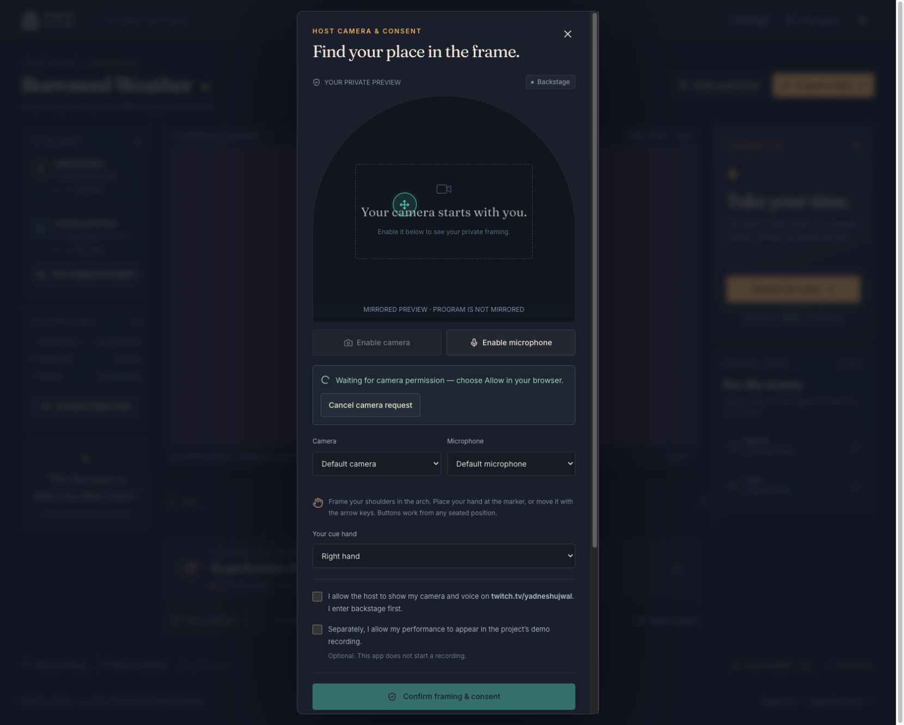
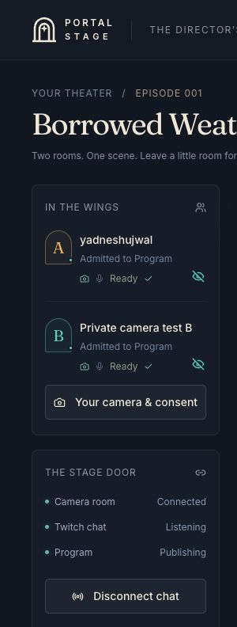
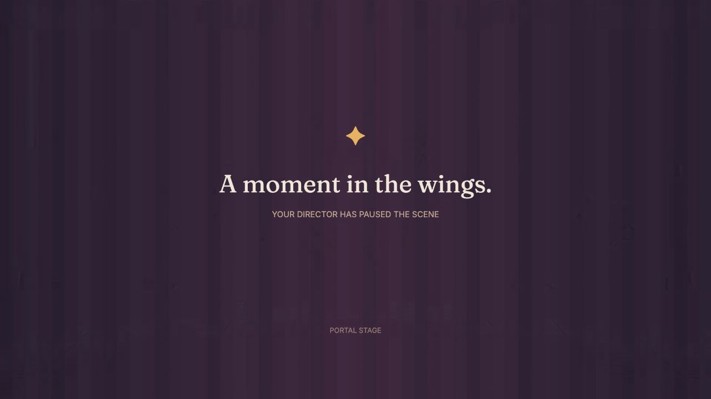
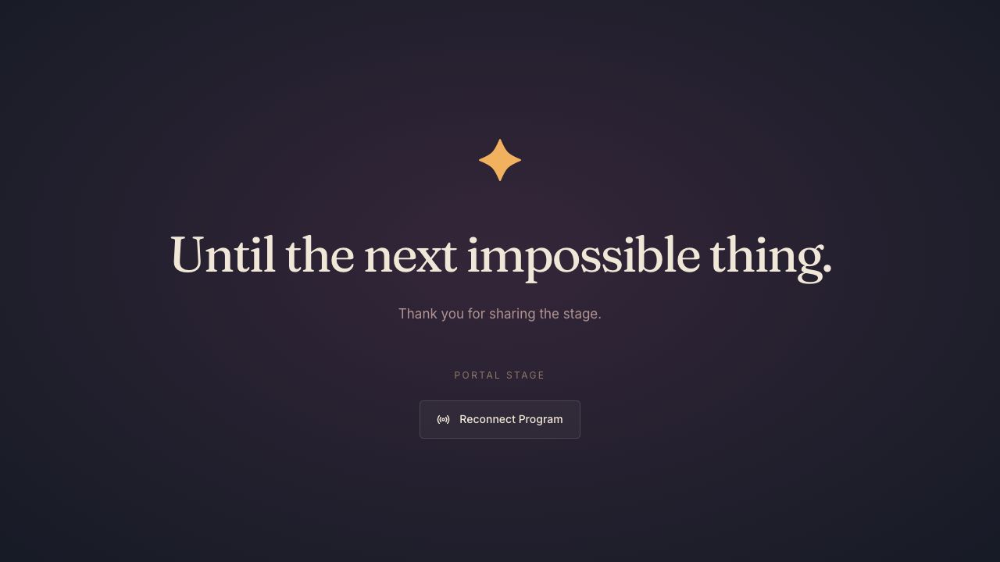
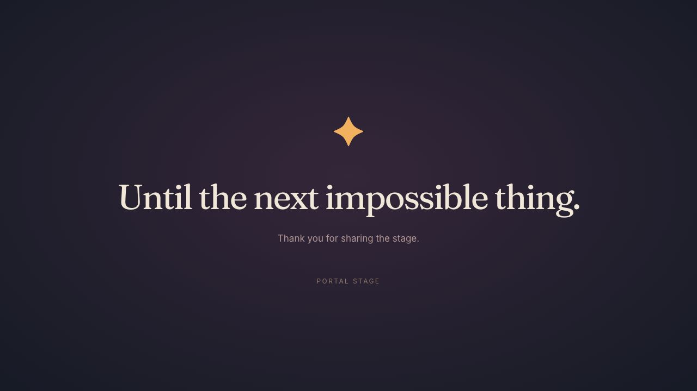

# Production in-app browser verification

Observed on 31 October 2026 at [portal-stage-eight.vercel.app](https://portal-stage-eight.vercel.app). Initial production release: source `bf5cf4df746dff48c700e8548516b0cfdc2dbc66`, Vercel deployment `dpl_2SJnnjbvEHn5XhCbWtwPBXruvDnv`, reported Ready.

The camera-feedback update is source `12df783729263a051264ddeef88a29b7aa8ccae7`, deployment `dpl_BQ2GG9TznHmoqatAx8YoBzT9nhTQ`, also Ready on the same canonical URL. The public synthetic rehearsal below belongs to the initial release. That deployment subsequently passed the physical-camera/LiveKit Cloud story, actual Twitch ballot replacement, emergency recovery, and shutdown described later in this record.

## Public experience

The public landing loaded without a Vercel login or other access gate. Its primary action created a labeled solo rehearsal. On show `ps_626f0fa0ece57a9b`, the browser exercised the full story: curtain, weather choice, one labeled wild test ballot, close choice, rain, offer and accept to B, Pip, offer and accept back to A, then shared shelter.

The umbrella `ps_626f0fa0ece57a9b-umbrella-1` retained its coral patch and 52% wetness, finishing with owner A/version6. Acceptance committed B at sequence9/version4 and A at sequence13/version6. Arrivals10 and14 did not rewrite ownership. The renderer epoch remained1. The [browser-exported recent event window](production-rehearsal-trace.json) contains all 15 observed events through shelter; it is not an immutable full audit log.

At a 390×844 viewport, the landing had no horizontal overflow: viewport390, document/body375 with the scrollbar accounted for. The heading, explanation, primary action, and illustrated show preview remained readable. The browser viewport was restored after the check.

## Live setup and deployed assets

The requested Twitch account completed the exact production callback using only `user:read:chat`. The resulting live show `ps_fb3398cc6bde0434` connected EventSub and displayed **Listening for !gentle and !wild in Twitch chat**. [Displayed connection status](production-twitch-status.txt) records this observation. The later live round counted two actual commands, as detailed below.

The production hand worker, hand-landmark model, and SIMD WASM returned HTTP200 and matched their local files byte for byte (2,871; 7,819,105; and 14,466,654 bytes respectively). The unauthenticated session endpoint returned HTTP200 with `Cache-Control: no-store, private`. The production browser reported no captured error/warning entries during these checks.

Dedicated LiveKit Cloud credentials authenticated successfully against its room service and are stored as server configuration. The account dashboard showed the Build plan and a $0 next invoice at the time of inspection. These are setup observations, not a claim of unlimited free usage or verified browser media.

## Camera permission feedback

After the final deployment, an explicit document reload and director-lease takeover loaded the new camera controls. Enable camera displayed the waiting notice, disabled duplicate requests, and exposed an enabled Cancel camera request control. No private preview video element existed because permission remained pending. The local browser had separately verified that Cancel removes the notice and restores the enabled camera button; the final full automated run passed 183 tests, with three opt-in database tests skipped.

The user subsequently allowed camera access for production and the separate local guest origin. The pending state above is historical evidence of the permission UX, not the final test status.

## Physical camera and LiveKit Cloud walkthrough

The camera-feedback deployment hosted director A and the Program viewer. Performer B used an independent cookie on `http://127.0.0.1:3201`, served from the same source with a separate development cache and the same Neon database/signing configuration/LiveKit Cloud project. Both sessions captured the same MacBook Pro camera on one computer and network. No synthetic-source flag was enabled. This verifies the physical-camera/cloud-SFU path with independent participant sessions; it does not establish a performance by two remote humans or separate-network reliability.

Both private cameras decoded at 1280×720. The Program viewer decoded the director's composed 1920×1080 stream, and B decoded a video-only 1920×1080 return. The [playback measurements](production-cloud-playback.json) show readyState 4, paused false, and advancing media times. The [LiveKit room inspection](production-cloud-media-rooms.json) shows A's and B's camera tracks only in backstage, a separate output publisher with composed video/audio in the Program room, and a receive-only Program viewer with no published tracks. Microphones stayed disabled; the existence of the compositor's audio track is not evidence of a voice or echo test.

After both performers became ready and were admitted, an actual Twitch weather window opened. The authorized channel account posted `!gentle`, then `!wild`. The [observed tallies](production-twitch-vote-replacement.txt) changed from gentle 1/wild 0 to gentle 0/wild 1. Events 22 and 23 identify non-synthetic Twitch votes, with the second replacing the first. The closed round had one unique voter, result `wild`, and source `audience`; applying it retained that source. This is a real integration test using the host's account, not evidence of independent audience engagement.

The actual receiver B accepted A's offer at sequence 27/version 4; arrival 28 did not change ownership again. Pip hatched with wild behavior at 29. B offered back, A accepted at 31/version 6, arrival 32 retained that version, and shared shelter completed at 33. The same umbrella retained its coral repair patch and 52% wetness throughout. The [cloud story export](production-cloud-story-trace.json) reaches sequence 41 after recovery; it contains 39 published events, with private consent events 6 and 14 omitted. Original exports and private consent details remain outside Git.

## Emergency recovery and shutdown

Close curtain produced the holding screen in the actual deployed Program stream. Both performers returned backstage and needed readiness and admission again. Turning B's camera off removed its published camera track; the [room inspection during withdrawal](production-cloud-camera-withdrawal.json) shows B with no tracks. Re-enabling the camera, marking both ready, admitting both, and resuming recovered the completed shelter with owner A/version 6 and unchanged traits. This was a camera off/on recovery while the media room stayed connected; the earlier full disconnect/reconnect check remains documented in [local verification](2026-10-31-local.md).

End the show committed sequence 42 and revoked invitations/output grants. Director camera room, Twitch, and Program all became disconnected/not publishing. Guest and Program video elements disappeared; all three tested pages had zero video elements. LiveKit returned [no remaining test rooms](production-cloud-shutdown.json). The [final trace](production-cloud-ended-trace.json) contains 40 published events through sequence 42, with the same two private consent events omitted. The [shutdown observations](production-cloud-shutdown-observations.json) retain the UI results and SDK console messages emitted during intentional disconnect: user-initiated data-channel aborts, closed-peer negotiation, and already-unpublished-track warnings. They did not leave a publisher or media element running.

No camera footage was recorded or committed, and no Twitch broadcast was started. Remaining checks are two consenting performers on separate devices/networks, physical hand-cue accuracy, microphone/echo/synchronization behavior, measured control/media delay, and OBS capture. The earlier independent-session synthetic SFU protocol check remains available in [local verification](2026-10-31-local.md).

## Final pending-camera shutdown hardening

Read-only cleanup review found a separate case outside the granted-camera walkthrough: ending an unjoined show while its camera permission request was still pending did not cancel that pending intent immediately. Source `a9fd9242ef69a9b6b5052168c9564e4d5e5e63be` adds the pending request to the end/disconnect guard. A focused regression proves that a late grant is stopped without attachment, token acquisition, or a media room; 42 focused tests and the full 184-test suite passed. No transport shutdown ordering or SDK logging was changed.

The final deployment `dpl_44zp8zqCqQFPLgxxP4Gofn8NdP6z` is Ready at the same canonical URL. After explicit browser reloads, the landing displayed its expected heading and the ended live show's Program displayed “Until the next impossible thing.” with zero video elements. The full physical-camera Cloud walkthrough above retains its preceding `12df783` deployment provenance; it was not repeated after this narrow pending-intent change.

