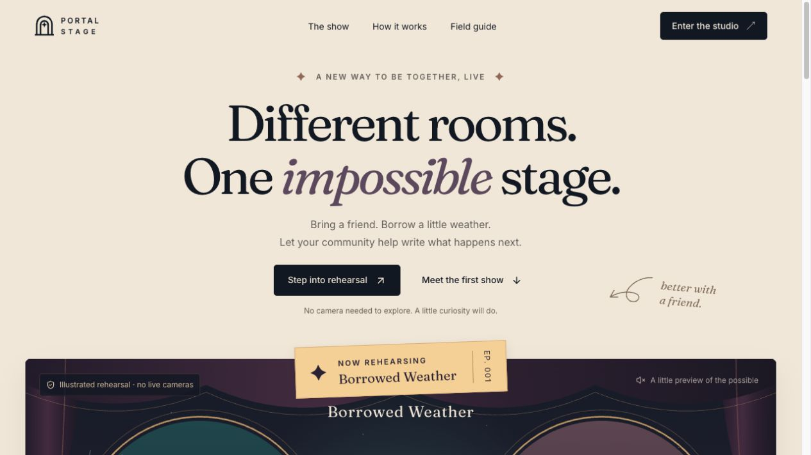
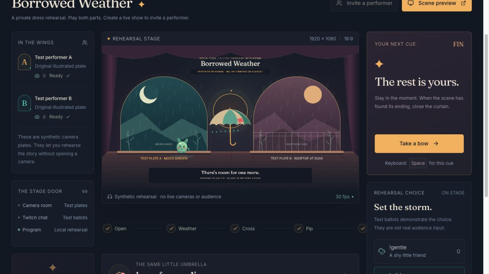
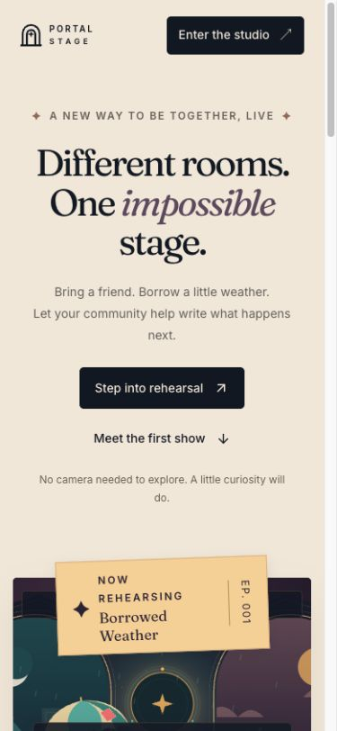

# Production in-app browser verification

Observed on 31 October 2026 at [portal-stage-eight.vercel.app](https://portal-stage-eight.vercel.app). Initial production release: source `bf5cf4df746dff48c700e8548516b0cfdc2dbc66`, Vercel deployment `dpl_2SJnnjbvEHn5XhCbWtwPBXruvDnv`, reported Ready.

## Public experience

The public landing loaded without a Vercel login or other access gate. Its primary action created a labeled solo rehearsal. On show `ps_626f0fa0ece57a9b`, the browser exercised the full story: curtain, weather choice, one labeled wild test ballot, close choice, rain, offer and accept to B, Pip, offer and accept back to A, then shared shelter.

The umbrella `ps_626f0fa0ece57a9b-umbrella-1` retained its coral patch and 52% wetness, finishing with owner A/version6. Acceptance committed B at sequence9/version4 and A at sequence13/version6. Arrivals10 and14 did not rewrite ownership. The renderer epoch remained1. The [browser-exported recent event window](production-rehearsal-trace.json) contains all 15 observed events through shelter; it is not an immutable full audit log.

At a 390×844 viewport, the landing had no horizontal overflow: viewport390, document/body375 with the scrollbar accounted for. The heading, explanation, primary action, and illustrated show preview remained readable. The browser viewport was restored after the check.

## Live setup and deployed assets

The requested Twitch account completed the exact production callback using only `user:read:chat`. The resulting live show `ps_fb3398cc6bde0434` connected EventSub and displayed **Listening for !gentle and !wild in Twitch chat**. [Displayed connection status](production-twitch-status.txt) records this observation. No actual PORTAL STAGE ballots have yet been counted; its weather window requires two ready/admitted performers and an open live stage.

The production hand worker, hand-landmark model, and SIMD WASM returned HTTP200 and matched their local files byte for byte (2,871; 7,819,105; and 14,466,654 bytes respectively). The unauthenticated session endpoint returned HTTP200 with `Cache-Control: no-store, private`. The production browser reported no captured error/warning entries during these checks.

Dedicated LiveKit Cloud credentials authenticated successfully against its room service and are stored as server configuration. The account dashboard showed the Build plan and a $0 next invoice at the time of inspection. These are setup observations, not a claim of unlimited free usage or verified browser media.

## Remaining media verification

The real camera check reached the in-app browser permission boundary. The app has requested access; the browser prompt requires the user's click because the computer-use tool cannot operate the Codex application's native permission UI. The live show remains backstage with no published Program.

Until that step completes, these production checks do not establish physical camera/microphone behavior, browser-to-cloud media transport, actual hand recognition, real PORTAL STAGE Twitch vote counting, two remote human performers, or an OBS/Twitch broadcast. The complete independent-session SFU protocol and recovery test is documented separately in [local verification](2026-10-31-local.md), using explicitly labeled generated video.
